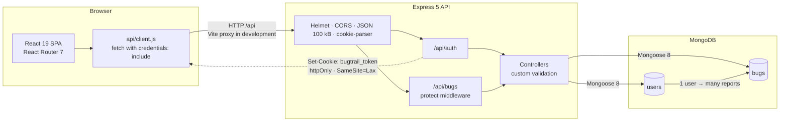

# BugTrail

**Personal Bug Tracking & Debugging Journal**

BugTrail is a full-stack MERN application for recording software bugs and preserving the debugging trail behind each fix. Every account has a private journal of reports that combines structured metadata — project, severity, status — with reproduction steps, expected and actual behaviour, investigation notes, and the final solution.

It is built as a focused tool for individual developers rather than a team issue tracker. The repository contains the React single-page application, the Express REST API, MongoDB models, an automated backend integration suite, and zero-dependency setup and development scripts. No hosted demo or screenshot assets are currently included.

> Implementation details in this README were checked against the source code on 10 November 2026.

## Table of Contents

1. [Project Title](#bugtrail)
2. [Project Overview](#project-overview)
3. [Key Features](#key-features)
4. [Screenshots](#screenshots)
5. [Technology Stack](#technology-stack)
6. [Application Architecture](#application-architecture)
7. [Project Structure](#project-structure)
8. [Installation and Setup](#installation-and-setup)
9. [Environment Variables](#environment-variables)
10. [Running the Application](#running-the-application)
11. [API Documentation](#api-documentation)
12. [Authentication and Security](#authentication-and-security)
13. [Testing](#testing)
14. [Known Limitations](#known-limitations)
15. [Future Improvements](#future-improvements)
16. [Author](#author)
17. [License](#license)

---

## Project Overview

### What BugTrail does

BugTrail is a private debugging journal. A signed-in user can create a bug report, classify it by project, severity and status, document how to reproduce it, compare the expected and actual results, record investigation notes, and write down the final solution. Reports can be searched, filtered by project, severity or status, and browsed through a paginated list or a dashboard summary.

### The problem it solves

Debugging context is usually scattered across terminal history, browser tabs, chat messages and short-lived notes. Once a bug is fixed, the reasoning behind the fix is often lost. That makes recurring bugs harder to diagnose and turns useful investigation work into undocumented knowledge.

BugTrail keeps the report and the trail together: the symptom, the reproduction path, the evidence, the dead ends, and the fix. Because entries are stored by project, they remain easy to find later.

### Why developers might use it

- **Continuity** — reopen a bug months later and understand what was tried, not just what changed.
- **Useful context** — recorded reproduction steps and expected/actual behaviour make reports reproducible.
- **Personal focus** — a private journal for one developer, without the overhead of configuring a team workflow.
- **Project awareness** — project-based filtering and a project summary make it practical to maintain several side projects or client applications.
- **Searchable history** — title search, status/severity/project filters, and a recent-activity dashboard make past work retrievable.

### Scope

BugTrail is intentionally a **single-user-per-account journal**. Each account can only read, update or delete its own bug reports; cross-user access returns `404`. It does not implement teams, shared workspaces, comments, or a general-purpose project-management workflow.

---

## Key Features

Every feature below is implemented in the current source. Paths are included where they help trace behaviour.

### Accounts and access

| Feature | Implementation |
| --- | --- |
| User registration | Account creation with name, email and password; inline validation; password visibility toggle; automatic sign-in after registration (`frontend/src/pages/RegisterPage.jsx`, `backend/src/controllers/authController.js`). |
| Login and logout | Email/password login, session refresh, and cookie-clearing logout (`frontend/src/pages/LoginPage.jsx`, `POST /api/auth/logout`). |
| Secure sessions | JWT stored in an `httpOnly` cookie named `bugtrail_token`; the frontend never reads or stores the token (`backend/src/utils/token.js`, `frontend/src/api/client.js`). |
| Route protection | `ProtectedRoute` sends unauthenticated users to `/login` and preserves the requested path; `PublicOnlyRoute` redirects signed-in users away from auth screens (`frontend/src/components/RouteGuards.jsx`). |
| Session bootstrap | On load, the SPA calls `GET /api/auth/me` and restores the current user or clears the session (`frontend/src/context/AuthContext.jsx`). |
| Private data isolation | Every bug query is scoped with `createdBy: req.user._id`; another user's report returns `404` rather than leaking its existence (`backend/src/controllers/bugController.js`). |

### Bug journal

| Feature | Implementation |
| --- | --- |
| Personal bug management | Create, view, edit and delete reports; all operations are user-scoped (`backend/src/controllers/bugController.js`, `frontend/src/pages/BugsPage.jsx`, `BugDetailPage.jsx`, `BugFormPage.jsx`). |
| Severity tracking | Four levels: `Low`, `Medium`, `High`, `Critical`; rendered as coloured badges and included in dashboard aggregates (`backend/src/utils/validation.js`, `frontend/src/components/Badges.jsx`). |
| Status tracking | Three states: `Open`, `In Progress`, `Resolved`; rendered as status badges (`backend/src/utils/validation.js`, `frontend/src/components/Badges.jsx`). |
| Reproduction steps | Dedicated free-text field with a 5,000-character limit (`backend/src/models/Bug.js`, `frontend/src/components/BugForm.jsx`). |
| Expected vs actual results | Separate fields, each capped at 2,000 characters, displayed side by side in the report detail view (`frontend/src/pages/BugDetailPage.jsx`). |
| Debugging journal | Investigation notes field for hypotheses, logs, dead ends and root-cause findings, up to 5,000 characters. |
| Solution documentation | Final fix or workaround field, up to 5,000 characters. |
| Resolution timestamp | `resolvedAt` is stamped when a report moves to `Resolved` and cleared when it moves back to another status (`backend/src/controllers/bugController.js`). |
| Full report detail | Detail page combines badges, project, created/updated/resolved dates, record ID, description, reproduction steps, expected/actual results, debugging notes and solution. |

### Discovery and organisation

| Feature | Implementation |
| --- | --- |
| Dashboard analytics | Total, open, in-progress and resolved counts; a CSS-rendered status donut; a severity breakdown; the top six projects; and the five most recent reports (`frontend/src/pages/DashboardPage.jsx`, `GET /api/bugs/stats`). |
| Project-based organisation | Project is a required free-text field on each report. The API exposes distinct project names for filtering, and the dashboard aggregates report counts by project. There is no separate Project collection. |
| Title search | Case-insensitive substring search on the bug title, trimmed to 120 characters and regex-escaped on the server (`backend/src/controllers/bugController.js`). |
| Filtering | Severity, status and exact project filters; all filter state is synchronised with the URL query string (`frontend/src/pages/BugsPage.jsx`, `frontend/src/components/BugFilters.jsx`). |
| Debounced search | The search input is debounced by 350 ms before updating the URL and issuing a request (`frontend/src/hooks/useDebouncedValue.js`). |
| Pagination | The UI requests 10 reports per page and renders a windowed page control. The API defaults to 12 and caps `limit` at 50 (`frontend/src/components/Pagination.jsx`, `backend/src/controllers/bugController.js`). |
| Sorting | The API supports `sort=newest`, `sort=oldest` and `sort=updated`. The current UI always requests the default `newest` order and does not expose a sort control. |
| Combined filters | Multiple filter changes fired in the same tick are merged through a params ref rather than a stale router closure (`frontend/src/pages/BugsPage.jsx`). |
| Clear filters | Restores the unfiltered journal and resets the search input. |

### Interface and quality

| Feature | Implementation |
| --- | --- |
| Dark and light themes | Token-based themes with a toggle; preference is persisted in `localStorage` under `bugtrail-theme`, with the system colour scheme used when no preference exists (`frontend/src/context/ThemeContext.jsx`, `frontend/src/index.css`). |
| Responsive interface | Breakpoints at 1180, 1024, 900, 860, 640 and 420 px. The desktop table becomes stacked cards; the sidebar becomes a drawer with a scrim; forms and detail layouts reflow (`frontend/src/index.css`). |
| Loading states | Dashboard, list and detail skeletons plus a full-page session loader (`frontend/src/components/Loading.jsx`). |
| Empty states | Dedicated states for an empty journal, no matching filters, no recent reports and missing optional journal content. |
| Error and retry states | API failures show a retryable error panel with a `Try again` action (`frontend/src/components/States.jsx`). |
| Toasts | Auto-dismissing notifications after 4.5 seconds, capped at three visible toasts (`frontend/src/context/ToastContext.jsx`). |
| Confirmation dialogs | Accessible delete dialogs with focus management, Escape handling, backdrop dismissal and focus restoration (`frontend/src/components/ConfirmDialog.jsx`). |
| Mirrored validation | Client-side rules mirror server-side rules; field errors are shown inline and the first invalid field receives focus (`frontend/src/components/BugForm.jsx`, `backend/src/utils/validation.js`). |
| Accessibility details | Skip link, labelled controls, `aria-*` attributes, visible focus styles, keyboard-dismissible drawer/dialog, and reduced-motion support. |
| Custom design system | One tokenised stylesheet with a teal/slate palette, no UI framework, no CSS preprocessor, and inline SVG icons rather than an icon dependency. |

### Security controls

| Feature | Implementation |
| --- | --- |
| Password hashing | `bcrypt` pre-save hook; passwords are `select: false` and excluded from the public user serialiser (`backend/src/models/User.js`). |
| Auth rate limiting | 30 attempts per 15 minutes on register and login; disabled automatically in the test environment (`backend/src/routes/authRoutes.js`). |
| Security headers and CORS | Helmet security headers; CORS restricted to `CLIENT_URL` with credentials enabled (`backend/src/app.js`). |
| Request hardening | JSON bodies capped at 100 kB, `x-powered-by` disabled, and centralised error normalisation. |
| Server-side validation | Custom validation for auth and bug payloads; Mongoose schema constraints provide a second layer (`backend/src/utils/validation.js`, `backend/src/models/Bug.js`). |

---

## Screenshots

No screenshots are currently included in this repository. The only image asset is `frontend/public/favicon.svg`. The table below is a labelled placeholder; the suggested paths do **not** exist yet.

| View | Suggested file | Status |
| --- | --- | --- |
| Dashboard | `docs/screenshots/dashboard.png` | Not included |
| All bugs / filters | `docs/screenshots/bug-list.png` | Not included |
| Bug detail / journal | `docs/screenshots/bug-detail.png` | Not included |
| Create or edit report | `docs/screenshots/bug-form.png` | Not included |
| Mobile layout | `docs/screenshots/mobile.png` | Not included |

To add real screenshots later, create a `docs/screenshots/` directory, capture the views above, and replace the placeholder rows with standard Markdown image embeds pointing at the added files.

---

## Technology Stack

Versions are taken from each package's `package.json` (declared range) and `package-lock.json` (installed version in this repository).

### Frontend

| Technology | Declared | Installed | Purpose |
| --- | --- | --- | --- |
| React | `^19.1.1` | `19.3.1` | UI components and state |
| React DOM | `^19.1.1` | `19.3.1` | Browser rendering |
| React Router DOM | `^7.9.3` | `7.18.5` | Client-side routing and route guards |
| Vite | `^7.1.7` | `7.3.8` | Development server and production build |
| `@vitejs/plugin-react` | `^5.0.4` | `5.2.0` | React support for Vite |
| Custom CSS | — | — | Tokenised design system, themes and responsive layout in `src/index.css` |

### Backend

| Technology | Declared | Installed | Purpose |
| --- | --- | --- | --- |
| Node.js | `>=20` | `v24.15.0` used in development | JavaScript runtime |
| Express | `^5.1.0` | `5.3.0` | HTTP API and static SPA serving |
| Mongoose | `^8.19.1` | `8.24.8` | MongoDB modelling and queries |
| `cookie-parser` | `^1.4.7` | `1.4.7` | Reading the auth cookie |
| `cors` | `^2.8.5` | `2.8.6` | Restricted cross-origin access |
| `dotenv` | `^16.4.5` | `16.6.1` | Loading `backend/.env` |

### Database

| Technology | Notes |
| --- | --- |
| MongoDB | Default development URI is `mongodb://127.0.0.1:27017/bugtrail`. A MongoDB Atlas URI can be supplied through `MONGODB_URI`. No MongoDB version is pinned in the repository. |

### Authentication and security

| Technology | Declared | Installed | Purpose |
| --- | --- | --- | --- |
| `jsonwebtoken` | `^9.0.2` | `9.0.3` | Signing and verifying session tokens |
| `bcrypt` | `^6.0.0` | `6.0.0` | Password hashing and comparison |
| `express-rate-limit` | `^8.1.0` | `8.7.4` | Registration/login throttling |
| `helmet` | `^8.1.0` | `8.3.0` | HTTP security headers |

### Development tools

| Tool | Notes |
| --- | --- |
| npm | `11.12.1` in the development environment; used for installs and root scripts |
| Node test runner | Built-in `node:test`; no external test framework |
| `node --watch` | Backend auto-restart during development |
| Vite build | `vite build` outputs `frontend/dist` |
| Git | Optional; used to clone the repository |

Not used: TypeScript, Tailwind CSS, a component library, a charting library, an icon package, Redux or another state-management library, Docker, or a CI configuration.

---

## Application Architecture

### Frontend to backend

The frontend is a React single-page application built with Vite. All API calls go through `frontend/src/api/client.js`, which uses the browser `fetch` API with `credentials: 'include'`. The JWT is therefore sent as a cookie and is never exposed to application JavaScript.

In development, Vite serves the app on port `5173` and proxies `/api` requests to the Express server on port `5000` (`frontend/vite.config.js`). Because the browser sees a single origin, the auth cookie remains first-party.

### API architecture

The Express API is mounted under `/api`:

- `/api/auth` handles registration, login, logout and current-user lookup.
- `/api/bugs` is protected as a whole by the `protect` middleware.
- Controllers validate input, apply ownership filters, and return JSON.
- A central error handler converts Mongoose validation errors, cast errors, duplicate-key errors and malformed JSON into consistent JSON responses.
- In production, if `frontend/dist/index.html` exists, Express serves the built SPA and falls back to `index.html` for non-API `GET` requests.

### Request lifecycle

1. Helmet adds security headers.
2. CORS checks the request origin against `CLIENT_URL` and allows credentials.
3. The JSON body parser accepts payloads up to 100 kB.
4. `cookie-parser` exposes `req.cookies`.
5. The route runs; `/api/bugs` first passes through `protect`.
6. `protect` verifies the JWT from the `bugtrail_token` cookie or an `Authorization: Bearer` header, loads the user, and assigns `req.user`.
7. The controller validates the payload, applies `createdBy: req.user._id`, and calls Mongoose.
8. The response is returned as JSON; errors are normalised by `errorHandler`.

### Architecture diagram



### Database relationships

There are two Mongoose models:

- **User** — `name`, `email`, `password`, and timestamps. Email is unique, lower-cased and trimmed. The password hash is excluded from normal queries with `select: false`.
- **Bug** — report fields plus `createdBy`, a required `ObjectId` reference to `User`, and timestamps.

The relationship is one-to-many: one user owns many bug reports. `Bug` has compound indexes on `createdBy` combined with `createdAt`, `status`, `severity` and `project` to support the dashboard and filtered lists. There is no separate `Project` model; project names are free-text values on each report.

---

## Project Structure

```text
bugtrail/
├── backend/
│   ├── src/
│   │   ├── config/
│   │   │   ├── db.js              # MongoDB connection helpers
│   │   │   └── env.js             # Environment parsing and required-secret check
│   │   ├── controllers/
│   │   │   ├── authController.js  # Register, login, logout, current user
│   │   │   └── bugController.js   # CRUD, search, filters, stats, projects
│   │   ├── middleware/
│   │   │   ├── auth.js            # JWT cookie/Bearer guard
│   │   │   └── errorHandler.js    # 404 and central error responses
│   │   ├── models/
│   │   │   ├── User.js            # User schema, bcrypt hook, public serialiser
│   │   │   └── Bug.js             # Bug schema, enums, limits, indexes
│   │   ├── routes/
│   │   │   ├── authRoutes.js      # /api/auth
│   │   │   └── bugRoutes.js       # /api/bugs
│   │   ├── utils/
│   │   │   ├── token.js           # JWT signing, cookie name and options
│   │   │   └── validation.js      # Shared validation rules
│   │   ├── app.js                 # Express app and middleware
│   │   └── server.js              # DB connection, HTTP server, shutdown
│   ├── tests/
│   │   └── api.test.js            # Integration suite (17 tests)
│   ├── .env.example               # Documented backend environment template
│   ├── package.json
│   └── package-lock.json
├── frontend/
│   ├── public/
│   │   └── favicon.svg
│   ├── src/
│   │   ├── api/
│   │   │   └── client.js          # Fetch wrapper, ApiError, endpoint helpers
│   │   ├── components/            # Layout, forms, lists, filters, states, dialogs
│   │   ├── context/               # Auth, Theme and Toast providers
│   │   ├── hooks/                 # Debounce and document-title hooks
│   │   ├── pages/                 # Auth, dashboard, bug list/form/detail, 404
│   │   ├── utils/                 # Constants, badges and formatters
│   │   ├── App.jsx                # Routes, guards and scroll restoration
│   │   ├── main.jsx               # React root and providers
│   │   └── index.css              # Design system, themes and responsive CSS
│   ├── index.html
│   ├── vite.config.js             # Port 5173 and /api proxy to port 5000
│   ├── .env.example               # Frontend API base template
│   ├── package.json
│   └── package-lock.json
├── scripts/
│   ├── dev.js                     # Starts API and Vite together
│   └── setup.js                   # Creates backend/.env and installs dependencies
├── .gitignore                     # Ignores node_modules, dist, .env and logs
├── PROJECT_CONTEXT.md             # Architecture decisions and status notes
├── TASKS.md                       # Development task tracker
├── README.md
└── package.json                   # Root setup, dev, test, build and start scripts
```

Important conventions:

- `backend/.env` is generated locally and ignored by Git; `backend/.env.example` is the committed template.
- `frontend/dist` is generated by `npm run build` and is not committed.
- `node_modules` is installed separately in `backend/` and `frontend/`; the root package has no dependencies.
- `docs/screenshots/` does not exist yet; the screenshot section uses placeholders.

---

## Installation and Setup

### Prerequisites

| Requirement | Details |
| --- | --- |
| Node.js | **20 or newer** (`engines.node` in both packages). The project was developed on `v24.15.0`. |
| npm | Installed with Node. The development environment used `11.12.1`. |
| MongoDB | A running MongoDB instance, either local (`mongodb://127.0.0.1:27017/bugtrail`) or a MongoDB Atlas connection string. |
| Git | Optional, only needed to clone the repository. |
| Free ports | `5000` for the API and `5173` for the Vite development server by default. |

### 1. Clone the repository

```bash
git clone <repository-url>
cd bugtrail
```

Replace `<repository-url>` with the URL of this repository. If the project is already on your machine, skip the clone step and open a terminal in the `bugtrail` directory.

### 2. Install dependencies and create the backend environment file

From the project root:

```bash
npm run setup
```

`scripts/setup.js` does two things:

1. If `backend/.env` does not exist, it copies `backend/.env.example` and replaces the placeholder `JWT_SECRET` with a random 96-character hexadecimal secret.
2. It runs `npm install` in both `backend/` and `frontend/`.

The setup script does not overwrite an existing `backend/.env`.

### 3. Manual installation (alternative)

```bash
npm install --prefix backend
npm install --prefix frontend
```

Then create the environment file:

**PowerShell (Windows):**

```powershell
Copy-Item backend\.env.example backend\.env
```

**macOS / Linux:**

```bash
cp backend/.env.example backend/.env
```

Open `backend/.env` and set a long random `JWT_SECRET`. The example file suggests generating one with:

```bash
node -e "console.log(require('crypto').randomBytes(48).toString('hex'))"
```

### 4. MongoDB setup

**Local MongoDB**

Start MongoDB and confirm it is listening on `127.0.0.1:27017`. The default URI in `backend/.env.example` is:

```text
mongodb://127.0.0.1:27017/bugtrail
```

Mongoose creates the `bugtrail` database and its collections on first write. There is no migration or seed script.

**MongoDB Atlas**

Create a cluster and set `MONGODB_URI` in `backend/.env` to the Atlas connection string. If you use a database user, include the credentials in the URI and allow your IP address in Atlas.

> The automated backend tests require a local MongoDB instance because `backend/tests/api.test.js` sets `MONGODB_URI` to `mongodb://127.0.0.1:27017/bugtrail_test`.

### 5. Optional frontend environment

The frontend defaults to `/api`, which works with the Vite proxy. To point at a different API origin, create `frontend/.env` from `frontend/.env.example` and set:

```text
VITE_API_BASE_URL=https://api.example.com/api
```

Do not put secrets in a `VITE_*` variable: Vite inlines those values into the client bundle.

### 6. Start the development servers

```bash
npm run dev
```

Open **http://localhost:5173**. The API runs at **http://localhost:5000**.

---

## Environment Variables

### Backend (`backend/.env`)

| Variable | Required | Default | Purpose |
| --- | --- | --- | --- |
| `PORT` | No | `5000` | Port the Express API listens on. |
| `NODE_ENV` | No | `development` | `production` enables secure cookies and generic 5xx messages; `test` suppresses the database log and disables the auth rate limiter. |
| `MONGODB_URI` | No | `mongodb://127.0.0.1:27017/bugtrail` | MongoDB connection string. Required in practice for any non-default database. |
| `JWT_SECRET` | **Yes** | — | Secret used to sign JWTs. The server refuses to start without it. Never commit the real value. |
| `JWT_EXPIRES_IN` | No | `7d` | JWT lifetime. The cookie `maxAge` is derived from this value; the cookie parser supports `s`, `m`, `h` and `d` units. |
| `BCRYPT_ROUNDS` | No | `12` | bcrypt cost factor used when hashing passwords. Tests use `4` for speed. |
| `CLIENT_URL` | No | `http://localhost:5173` | Allowed CORS origin for the frontend. |

Example `backend/.env` with placeholder values only:

```dotenv
PORT=5000
NODE_ENV=development
MONGODB_URI=mongodb://127.0.0.1:27017/bugtrail
JWT_SECRET=replace-with-a-long-random-secret
JWT_EXPIRES_IN=7d
BCRYPT_ROUNDS=12
CLIENT_URL=http://localhost:5173
```

The committed template is `backend/.env.example`.

### Frontend (`frontend/.env`)

| Variable | Required | Default | Purpose |
| --- | --- | --- | --- |
| `VITE_API_BASE_URL` | No | `/api` | API base URL. Leave as `/api` in development so Vite proxies requests to the backend. Use a full URL when the frontend and API are hosted on different origins. |

The committed template is `frontend/.env.example`.

> Never place secrets, database credentials or private keys in frontend environment variables. Anything prefixed with `VITE_` is embedded in the client bundle.

---

## Running the Application

### Development mode

From the project root:

```bash
npm run dev
```

`scripts/dev.js` starts both processes and stops both when either exits or when you press `Ctrl+C`.

| Service | URL | Notes |
| --- | --- | --- |
| React app | http://localhost:5173 | Vite development server with HMR |
| Express API | http://localhost:5000 | API base path `/api` |
| Health check | http://localhost:5000/api/health | Public JSON health response |

### Run the services separately

```bash
npm run dev:backend
```

Starts the API with `node --watch src/server.js`.

```bash
npm run dev:frontend
```

Starts Vite. The frontend expects the API at `http://localhost:5000` because of the proxy in `frontend/vite.config.js`.

### Root scripts

| Command | Action |
| --- | --- |
| `npm run setup` | Create `backend/.env` if missing and install backend/frontend dependencies |
| `npm run dev` | Start the API and Vite together |
| `npm run dev:backend` | Start the backend development server only |
| `npm run dev:frontend` | Start the Vite development server only |
| `npm test` | Run the backend integration suite |
| `npm run build` | Build the frontend into `frontend/dist` |
| `npm start` | Start the backend in normal mode |

### Production-style local run

Build the SPA, then let Express serve it:

```bash
npm run build
npm start
```

- `npm run build` runs `vite build` and writes `frontend/dist`.
- `npm start` runs `node src/server.js` in the backend.
- If `frontend/dist/index.html` exists, Express serves the built app and falls back to `index.html` for non-API `GET` routes.
- Open **http://localhost:5000** (or the configured `PORT`).

For a production deployment, also set:

```dotenv
NODE_ENV=production
JWT_SECRET=<strong-random-secret>
MONGODB_URI=<production-database-uri>
CLIENT_URL=<frontend-origin>
```

With `NODE_ENV=production`, the auth cookie is marked `Secure`, so the app must be served over HTTPS for the browser to store it.

### Health check

```http
GET /api/health
```

The response has the shape:

```json
{
  "status": "ok",
  "service": "bugtrail-api",
  "uptime": 12.34
}
```

### Troubleshooting

| Symptom | Check |
| --- | --- |
| `Missing backend/.env` when running `npm run dev` | Run `npm run setup`, or create `backend/.env` from the example. |
| MongoDB connection error | Confirm MongoDB is running and `MONGODB_URI` is correct. The connection attempt times out after 10 seconds. |
| Port already in use | Change `PORT` and the Vite proxy target together, or stop the process using the port. |
| CORS error | `CLIENT_URL` must exactly match the frontend origin, including protocol and port. |
| Signed-in requests return `401` | The JWT may have expired. Sign in again. Logout clears the cookie but does not revoke an already-issued token. |
| Cookie not stored in production | `NODE_ENV=production` makes the cookie `Secure`; serve the app over HTTPS. |

---

## API Documentation

### Base URL and conventions

- Base path: `/api`
- Request and response format: JSON
- Authentication: `bugtrail_token` httpOnly cookie, or `Authorization: Bearer <token>` for tooling
- Bug IDs are MongoDB `ObjectId` strings
- All `/api/bugs` endpoints require authentication

### Endpoints

| Method | Endpoint | Description | Authentication |
| --- | --- | --- | --- |
| `GET` | `/api/health` | Service health and uptime | No |
| `POST` | `/api/auth/register` | Create an account and start a session | No; rate-limited |
| `POST` | `/api/auth/login` | Sign in and refresh the session cookie | No; rate-limited |
| `POST` | `/api/auth/logout` | Clear the session cookie | No |
| `GET` | `/api/auth/me` | Return the current user | Yes |
| `GET` | `/api/bugs` | List, search, filter, sort and paginate reports | Yes |
| `POST` | `/api/bugs` | Create a bug report | Yes |
| `GET` | `/api/bugs/stats` | Dashboard counts, severity/project aggregates and recent reports | Yes |
| `GET` | `/api/bugs/projects` | Distinct project names for the current user | Yes |
| `GET` | `/api/bugs/:id` | Return one full bug report | Yes |
| `PUT` | `/api/bugs/:id` | Replace the editable fields of a report | Yes |
| `DELETE` | `/api/bugs/:id` | Delete a report | Yes |

### `GET /api/bugs` query parameters

| Parameter | Type | Default | Behaviour |
| --- | --- | --- | --- |
| `search` | string | `""` | Case-insensitive title substring; trimmed and limited to 120 characters. |
| `severity` | string | `""` | `Low`, `Medium`, `High` or `Critical`. Invalid values are ignored. |
| `status` | string | `""` | `Open`, `In Progress` or `Resolved`. Invalid values are ignored. |
| `project` | string | `""` | Exact, case-insensitive project name; trimmed and limited to 80 characters. |
| `sort` | string | `newest` | `newest`, `oldest` or `updated`. Unknown values fall back to `newest`. |
| `page` | integer | `1` | Values below 1 or invalid values fall back to page 1. |
| `limit` | integer | `12` | Values below 1 fall back to 12; values above 50 are capped at 50. The UI sends 10. |

List responses include summary fields only: `title`, `description`, `project`, `severity`, `status`, `createdAt`, `updatedAt` and `resolvedAt`. The full journal fields are returned by `GET /api/bugs/:id`.

Example response:

```json
{
  "bugs": [
    {
      "_id": "6712f4c2a1b2c3d4e5f60718",
      "title": "Checkout button unresponsive on Safari",
      "description": "The primary checkout button does nothing when tapped in Safari 17.",
      "project": "Storefront",
      "severity": "High",
      "status": "Open",
      "createdAt": "2026-11-10T09:15:00.000Z",
      "updatedAt": "2026-11-10T09:15:00.000Z",
      "resolvedAt": null
    }
  ],
  "pagination": {
    "page": 1,
    "limit": 12,
    "total": 1,
    "pages": 1
  }
}
```

### Bug request body

Used by `POST /api/bugs` and `PUT /api/bugs/:id`:

| Field | Type | Required | Rules |
| --- | --- | --- | --- |
| `title` | string | Yes | 3–140 characters after trimming |
| `description` | string | Yes | 10–5,000 characters after trimming |
| `project` | string | Yes | 2–80 characters after trimming |
| `severity` | string | No | `Low`, `Medium`, `High` or `Critical`; defaults to `Medium` |
| `status` | string | No | `Open`, `In Progress` or `Resolved`; defaults to `Open` |
| `reproductionSteps` | string | No | Up to 5,000 characters; defaults to an empty string |
| `expectedResult` | string | No | Up to 2,000 characters; defaults to an empty string |
| `actualResult` | string | No | Up to 2,000 characters; defaults to an empty string |
| `debuggingNotes` | string | No | Up to 5,000 characters; defaults to an empty string |
| `solution` | string | No | Up to 5,000 characters; defaults to an empty string |

Example:

```json
{
  "title": "Checkout button unresponsive on Safari",
  "description": "The primary checkout button does nothing when tapped in Safari 17.",
  "project": "Storefront",
  "severity": "High",
  "status": "Open",
  "reproductionSteps": "1. Open Safari\n2. Add an item to the cart\n3. Tap Checkout",
  "expectedResult": "The checkout modal opens.",
  "actualResult": "Nothing happens.",
  "debuggingNotes": "The listener appears to be attached before hydration.",
  "solution": ""
}
```

`PUT` is a full-document update of the editable fields, not a partial patch. Omitted optional journal fields are stored as empty strings. `createdBy`, `resolvedAt` and timestamps are server-controlled and are not accepted from the client.

When `status` is `Resolved`, the server stamps `resolvedAt` if it is not already set. Moving a report back to `Open` or `In Progress` clears `resolvedAt`.

### Response shapes

| Endpoint | Success | Body |
| --- | --- | --- |
| `POST /api/auth/register` | `201` | `{ "user": { "id", "name", "email", "createdAt" } }` plus `Set-Cookie` |
| `POST /api/auth/login` | `200` | `{ "user": { "id", "name", "email", "createdAt" } }` plus `Set-Cookie` |
| `POST /api/auth/logout` | `200` | `{ "message": "Signed out successfully." }` |
| `GET /api/auth/me` | `200` | `{ "user": { "id", "name", "email", "createdAt" } }` |
| `POST /api/bugs` | `201` | `{ "bug": { ... } }` |
| `GET /api/bugs/:id` | `200` | `{ "bug": { ... } }` |
| `PUT /api/bugs/:id` | `200` | `{ "bug": { ... } }` |
| `DELETE /api/bugs/:id` | `200` | `{ "message": "Bug deleted." }` |
| `GET /api/bugs/projects` | `200` | `{ "projects": ["Media Pipeline", "Storefront"] }` |

The stats endpoint returns:

```json
{
  "counts": {
    "total": 2,
    "open": 1,
    "inProgress": 1,
    "resolved": 0
  },
  "bySeverity": {
    "Low": 0,
    "Medium": 0,
    "High": 1,
    "Critical": 1
  },
  "projects": [
    { "name": "Media Pipeline", "count": 1 },
    { "name": "Storefront", "count": 1 }
  ],
  "recent": []
}
```

`recent` contains up to five summary records ordered by newest first. `projects` contains up to six project groups ordered by count, then name.

### Errors

Errors use a consistent JSON shape:

```json
{
  "message": "Please fix the highlighted fields.",
  "errors": {
    "title": "Title must be at least 3 characters."
  }
}
```

| Status | Meaning |
| --- | --- |
| `400` | Malformed JSON, invalid identifier, or another bad request |
| `401` | Missing, invalid or expired session; incorrect login credentials |
| `404` | Bug or API route not found; includes cross-user bug IDs |
| `409` | Email address already registered |
| `422` | Validation failed; `errors` maps field names to messages |
| `429` | Too many register/login attempts in the rate-limit window |
| `500` | Unexpected server error; production responses use a generic message |

---

## Authentication and Security

### Authentication flow

1. **Registration** — the server validates the name, email and password, checks for an existing email, hashes the password with bcrypt in a Mongoose pre-save hook, creates the user, signs a JWT and sets the auth cookie. The response is `201` and contains only the public user fields.
2. **Login** — the server validates the payload, loads the user with `+password`, compares the candidate password with bcrypt, and issues a fresh JWT cookie. A wrong email or password returns the same generic `401` message.
3. **Authenticated request** — `protect` reads the `bugtrail_token` cookie (or a Bearer token), verifies the JWT, loads the user by the token's `sub` claim, and attaches the user to `req.user`.
4. **Session bootstrap** — the React app calls `GET /api/auth/me` on load. A success restores the user; a failure leaves the app signed out and protected routes redirect to `/login`.
5. **Logout** — the server clears the cookie with matching path and security options. The frontend clears its user state and redirects to `/login`.

### Cookie settings

| Property | Value |
| --- | --- |
| Name | `bugtrail_token` |
| `httpOnly` | `true` — not readable by JavaScript |
| `sameSite` | `Lax` |
| `secure` | `true` when `NODE_ENV=production`, otherwise `false` |
| `path` | `/` |
| `maxAge` | Derived from `JWT_EXPIRES_IN`; defaults to 7 days |

The JWT is signed with `JWT_SECRET` and contains the user ID as the `sub` claim. The frontend uses `credentials: 'include'` and never accesses `document.cookie` for authentication.

### Password handling

- Passwords are hashed with bcrypt using `BCRYPT_ROUNDS` (default 12).
- The `password` field is `select: false`, so it is not returned by normal queries.
- `toPublicJSON()` exposes only `id`, `name`, `email` and `createdAt`.
- Login returns a generic error for both an unknown email and a wrong password.
- Registration requires at least 8 characters, including at least one letter and one number.

### User data isolation

Every bug query includes `createdBy: req.user._id`. This applies to list, stats, project lookup, detail, update and delete. Requesting another user's report returns `404`, which avoids confirming whether the record exists. The integration suite explicitly verifies this behaviour.

### Rate limiting and request protections

- `POST /api/auth/register` and `POST /api/auth/login` are limited to **30 attempts per 15 minutes** per client.
- The limiter is skipped when `NODE_ENV=test`.
- Helmet sets security headers on every response.
- CORS allows only `CLIENT_URL` and enables credentials.
- JSON request bodies are limited to 100 kB.
- `x-powered-by` is disabled.
- `trust proxy` is set to `1` for deployments behind a single reverse proxy.
- Validation is performed server-side regardless of client-side checks.
- Unexpected `5xx` errors are logged server-side and returned as a generic message in production.

### Security limitations

- Logout is cookie-side only. An already-issued stateless JWT remains valid until it expires.
- There is no refresh-token rotation or server-side token revocation list.
- No explicit CSRF token is implemented. The cookie is `SameSite=Lax` and CORS is restricted to `CLIENT_URL`, but this is not a substitute for a dedicated CSRF strategy in every deployment.
- Email verification, password reset, two-factor authentication and account lockout beyond rate limiting are not implemented.
- Rate limiting is applied to auth routes only, not to bug CRUD routes.

---

## Testing

### Backend integration suite

Run from the project root:

```bash
npm test
```

This executes `node --test --test-concurrency=1` in `backend/`.

The suite uses a real local MongoDB instance with these test-specific settings, configured inside `backend/tests/api.test.js`:

| Setting | Value |
| --- | --- |
| `NODE_ENV` | `test` |
| `MONGODB_URI` | `mongodb://127.0.0.1:27017/bugtrail_test` |
| `JWT_SECRET` | A test-only value |
| `JWT_EXPIRES_IN` | `1h` |
| `BCRYPT_ROUNDS` | `4` |
| Auth rate limiter | Disabled |

The test database is dropped before and after the suite, so the development `bugtrail` database is not touched.

### Verified result

Last verified run on 10 November 2026:

```text
tests 17
pass 17
fail 0
cancelled 0
skipped 0
```

| Area | Tests | Result |
| --- | --- | --- |
| Health check | 1 | Pass |
| Registration, login, logout, session cookie, current user | 7 | Pass |
| Authentication guard and bug validation | 2 | Pass |
| Bug create, read, update, delete | 4 | Pass |
| Search and filters | 1 | Pass |
| Dashboard stats and project list | 1 | Pass |
| Cross-user isolation | 1 | Pass |
| **Total** | **17** | **17 passed, 0 failed** |

### Frontend build verification

The frontend has no automated test script or test framework configured. The available build check is:

```bash
npm run build
```

This runs `vite build` and writes `frontend/dist`. The production build was verified successfully during development.

### Manual browser verification

The following flows were checked manually in a browser during development:

- Registration, logout, protected-route redirect and login redirect-back.
- Create, view, edit, resolve and delete a bug report, including `resolvedAt`.
- Title search; severity, status and project filters; combined same-tick filter updates; empty filter state; clear filters; deep-linked filter URLs.
- Client-side validation, focus on the first invalid field, and the 404 route.
- Loading skeletons, retryable error states and recovery via `Try again`.
- Dark/light theme switching and persistence.
- Desktop (1440×900), tablet (768×1024) and mobile (390×844) layouts.

No CI workflow is configured in the repository.

---

## Known Limitations

- **Single-user model** — there are no teams, shared projects, comments or role-based access. Every report belongs to exactly one account.
- **Stateless logout** — clearing the cookie does not invalidate an already-issued JWT; the token remains valid until its expiry.
- **No account recovery** — password reset, email verification, profile editing and password changes are not implemented.
- **No attachments** — reports cannot include screenshots or files; journal content is text only.
- **Title-only search** — search does not cover descriptions, reproduction steps or debugging notes, and it uses a case-insensitive regex rather than a full-text index.
- **No sort control in the UI** — the API supports `newest`, `oldest` and `updated`, but the current interface always uses the default newest ordering.
- **Projects are strings** — there is no separate project entity, rename operation or cascade when a project name changes.
- **Permanent deletes** — there is no soft delete, trash or audit history.
- **No data portability** — reports cannot be exported to Markdown, JSON or CSV, and there is no import flow.
- **No CSRF token** — the app relies on `SameSite=Lax`, restricted CORS and JSON requests rather than a dedicated CSRF token.
- **Auth-only rate limiting** — bug CRUD endpoints are not rate-limited.
- **No hosted deployment or live demo** — the repository contains local development and production-style serving instructions, but no deployment configuration or public URL.
- **No automated frontend or end-to-end tests** — frontend verification is currently manual plus the production build.

---

## Future Improvements

None of the following are implemented. They are potential next steps, roughly in order of impact for a portfolio or small production deployment:

| Area | Potential improvement |
| --- | --- |
| Deployment | Add a deployment guide and a live demo (for example, a Node host plus MongoDB Atlas), with environment-specific configuration. |
| Session security | Add refresh-token rotation and server-side token revocation so logout can invalidate issued sessions. |
| Account lifecycle | Add password reset, email verification, profile editing and password changes. |
| Attachments | Support screenshots and log files on bug reports, with storage and validation. |
| Collaboration | Introduce team workspaces, shared projects and report comments while preserving the current personal-journal mode. |
| Search and discovery | Add full-text search across all journal fields and expose a sort control in the UI. |
| Data portability | Add Markdown/JSON export and an import flow for migrating existing journals. |
| Quality | Add frontend unit/component tests, end-to-end tests and a CI workflow that runs the backend suite and production build. |
| Auditability | Add soft delete, restoration and a change history for reports. |
| Operations | Add structured request logging, health/readiness endpoints, and a Docker Compose setup for local MongoDB. |
| Accessibility | Run a formal accessibility audit and add automated checks to the test pipeline. |
| Notifications | Add optional reminders for stale open reports or unresolved critical bugs. |

---

## Author

**Jithu Biju**

- GitHub: [@jithu378](https://github.com/jithu378)
- LinkedIn: [jithu-biju-](https://www.linkedin.com/in/jithu-biju-/)

BugTrail was built as a full-stack portfolio project and a practical personal debugging journal.

---

## License

No `LICENSE` file is currently present in this repository, so no open-source license is declared. If you intend to reuse or distribute this code, please contact the author to discuss permission.
